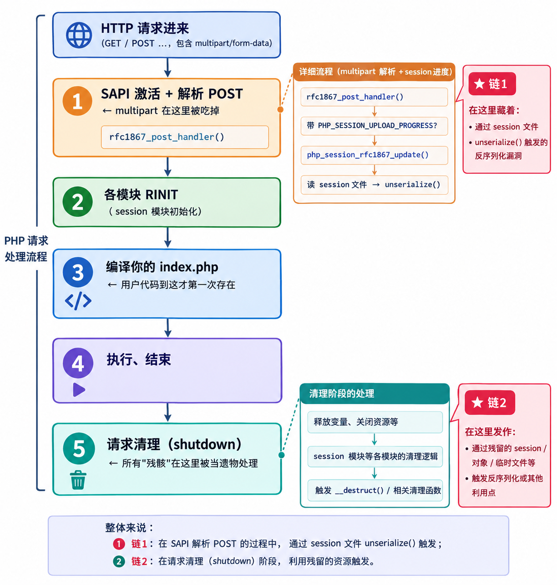
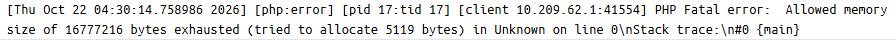
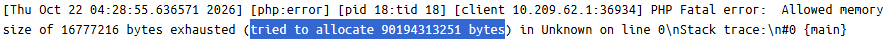

# 前言

2026‑10‑20，PHP 官方发了个预告，说第二天要出紧急安全补丁，修两个代号 PHP2Shell 的高危漏洞，CVE‑2026‑109618、CVE‑2026‑109619，CVSSv4 都是 9.2，无需认证的远程代码执行。10‑21 补丁如期放出。网传这次是因为细节提前泄露才提前准备的，官方原文倒没坐实，只留了句"细节公开或出现在野利用就提前发"。在此之前网上的信息很杂，吹得沸沸扬扬，说什么运行时与框架无关、无条件 RCE。但 PoC 后来公开出来我一看，好像不是这个样子，就来简单浅析一下这玩意吧。

# 原理

先说结论，不是什么无条件 RCE，也不是从 php5.x 一直爆到 php8.x。在 main/main.c 中的 php_request_startup() 函数其流程图大致如下:



一个 HTTP 请求在 PHP 内部经历解析，初始化，执行，清理等阶段。不同 SAPI 的细节和失败后的处理方式也不一样。这篇 [GHSA-w8hw-w9fx-j79w](https://github.com/php/php-src/security/advisories/GHSA-w8hw-w9fx-j79w) 中指出某些情况下，自动请求体解析会在应用代码执行之前触发内存耗尽；而在特定 SAPI 中，即使请求启动失败，也仍可能执行请求清理。原话这样说的

> PHP 使用 `longjmp()` 处理内存溢出 (OOM) 错误来退出当前上下文并中止请求处理。在某些情况下，请求内存可能在完全初始化之前暂时可用。如果此时任何内存分配失败，PHP 无法正确处理提前退出，导致请求内存处于无效状态。失败的内存分配不一定与无效内存相关。请求关闭过程可能会读取或跳转到该无效内存。

因此，如果一个请求在中途失败，PHP 不能保证所有已经被创建的请求被正确撤销。所以就会导致这次两种漏洞情况的发生。根据上面的流程图我们可以知道：上传进度功能为了记进度必须读写 session 文件，于是 unserialize 会在编译之前。而清理阶段又是另外的空间，如果一个请求在中途被打断就会留下一堆"半成品"没有被正确的清理。这个"半成品"会被当作正常的请求去接着执行就导致了漏洞的利用。

## 逻辑链

PHP 用 setjmp/longjmp 模拟中断，Zend/zend.h：

```c
#define zend_try                                       \
      {                                                  \
          JMP_BUF *__orig_bailout = EG(bailout);         \
          JMP_BUF __bailout;                             \
          EG(bailout) = &__bailout;                      \
          if (SETJMP(__bailout) == 0) {                  
  #define zend_catch                                     \
          } else {            /* longjmp 回到这里 */      \
              EG(bailout) = __orig_bailout;
  #define zend_end_try() ... }

  #define zend_bailout()  longjmp(*EG(bailout), FAILURE) 
```

memory_limit 耗尽时，Zend MM 里 `zend_bailout()` 又会瞬间跳回到 `if(SETJMP(__bailout) == 0)`，函数栈上所有局部变量直接蒸发。for 循环、if 分支里的清理代码都不会执行。堆上已经分配的内存也照样留在那儿，这导致了我们之前提到的请求清理会把他们当成品用。

**逻辑链**

再来看这个 `unserialize()` 的部分。upload-progress 收到带进度字段的 multipart 时，每个进度事件都要读-改-写 session 文件。读 = 解码 = unserialize()。官方补丁里面的 bug 说明:

```php
/* The upload progress handler (php_session_rfc1867_update()) decodes and
 * re-encodes the session during request startup, before RINIT, when no user
 * code may run.                                               "禁止用户代码"
 * Objects are then kept as __PHP_Incomplete_Class:           补丁后的做法
 * no autoloading, no unserialize_callback_func,
 * no __wakeup() or __unserialize(), and they are written back unchanged. */
```

打补丁之前，`unserialize` 碰到对象记录就会去查类存在，就会 `object_init_ex()` 实例化成真对象；对象引用的计数归零时，查一下 `zend_object_handlers.dtor_obj`，写 destruct() 方法就会被 C 层调用，在编译之前就会触发。所以整个过程就是 upload-progress 把 filename 原封不动写进进度树 -> 进度树序列化，如果 .user.ini 设置了 `session.serialize_handler=php_serialize`，就会构造出恶意的序列化对象。然后另一边 PHP handler 就会开始解码，php 格式解码器会遇到第一个 "|" 就会把内容分开，右边的内容就交给了 unserialize() 然后实例化对象，然后触发 destruct() 执行 shell_exec。

### 另一条路——内存链

```c
*value = '\0';
  do { value++; } while (isspace((unsigned char)*value));

  key = estrdup(line);                     
  smart_string_appends(&buf_value, value); //smart_string 最小就是 256B
```

打补丁前的代码是这样的，任何一次分配 OOM 给到 `zend_bailout()`。key 又泄露在堆上，buf_value 截断，#header 链表里可能已经有东西了。multipart 解析器每读一个头就做 estrdup + smart_string_appends（起步就是 256B），默认 post_max_size = 8M 而 6 字节的头就会放大到 314B，128M 的 memory_limit 用 2.57MB 请求体就能爆。而之前提到 `zend_bailout()` = longjmp，清理代码不会处理半成品请求，而是把它仍然当作成品在执行，逐个遍历这些结构，读的类型字段、长度字段正是能够受影响的 payload。PHP 把这些 payload 当 zend_string 读，实际内存是 zend_array。

剩下的就涉及 pwn 的知识了，我一个 web 狗看这些也很牢，但骨架其实就一句话：zend_string 和 zend_array 的内存布局天然重叠——h 正好压着 pDestructor，len 压着 nTableSize，val 压着 arData。所以同一个半成品内存，当 string 读就是截图里 84GiB 的数字分配，当 array 析构就是把 pDestructor 改写成 zif_system，zend_hash_destroy 一层层往下调，最后变成 system(cmd)。至于 zif_system 的地址从哪来——第一轮泄漏走 Set-Cookie 把 512B 堆内容带出来，反推 libphp 基址，ASLR 就这么绕掉的。根据本地的复现截图可以看看



解析期间就死了还没进 php 文件



悬空 PS(id) 被读成了 zend_string，放大到了约 84GiB

# 总结

所以最后总结一下利用条件（我一个 web 看这些 pwn 的也很牢）：

**OOM 链（109618）**：display_errors=On（生产版 php.ini 默认 Off）、memory_limit 能被打（设成 -1 直接免疫）、单 worker 或同 worker 连续命中、SAPI 无条件跑请求清理——这条最关键，官方点名 mod_php 风险最高，FrankenPHP 疑似，FPM 启动失败会直接杀 child 收窄。触发本身是真不难（2.57MB 在默认 post_max_size=8M 之内就能打到 OOM，WAF 也看不出异常），所以前面就是正常 DoS。真正难的是堆对齐：exp 里那些堆参数基本都是作者在自己 Linux 堆上校准的写死值，跨环境迁移很难命中——我本地复现 8.5.11 就是这样，三种结局：SIGSEGV、84GiB 天文数字分配、正常 cookie，就是打不中 512B 泄漏。而且泄漏步还得靠 display_errors 漏出来，生产环境这开关多半是关的。

**逻辑链（109619）**：条件是 session 端 serialize_handler 配错（两个目录 handler 不一致 + 共享 save_path）、目标环境预加载了带危险魔术方法的类（autoload 那个窗口被禁，没类就空转）、session.upload_progress.enabled 默认开、cleanup=Off 卡窗口，外加同一个 worker。8.5 还有条更屌的：fatal_error_backtraces 默认就是开的。都是配置错误或者环境自带 gadget 的前提，生产环境不好拿。

三个版本叙事都不对：不是无条件 RCE（每一层条件都能砍掉一大截）；不是 5.x 爆到 8.4（官方修的是 8.2.35/8.3.36/8.4.27/8.5.12，吹的范围反而漏了主战场 8.5，5.x 从来没官方处理过）；运行时无视框架倒是基本没错，对 mod_php 这类应用无关的攻击面成立，但换个 SAPI 就要重新打条件。补丁只堵了 RINIT 那扇门，普通 session_start() 路径没封，handler 配错 + 会话可写的话，打完补丁照样能打——官方也承认"升级是唯一可靠缓解"。
