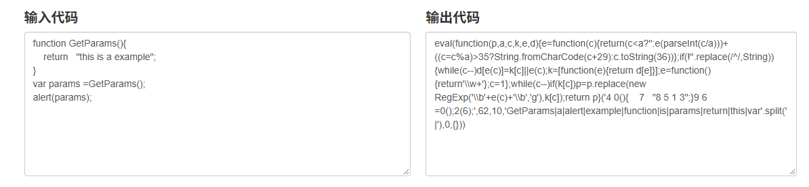
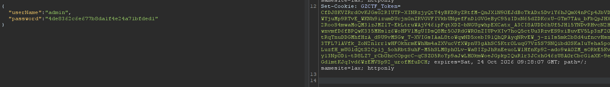
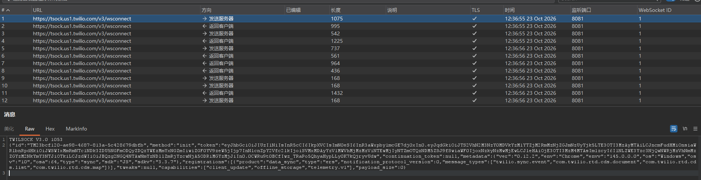
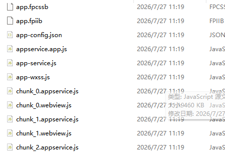

# 前言

一个 Web 狗的自我修养。


学了这么久了，也有一年了，浑浑噩噩的，抽课余时间学，还是很菜。又到了找班上的年纪。在此发现对于 Web 的学习或者说对于整个安全方向的学习，我着相了，为什么这么说呢？我总是想着从基础一步一步堆上去，但殊不知基础这个东西太广泛，我觉得应该是遇到一个去学一个，在学某个点的途中一定有你还不知道的其他点，就 tm 跟 goto 一样再点进去看接着学。看多了就记住了。


和我已有的一些基础串一下，本期是基础篇。

# 一些基础

> 我只能说会太基础，都是应该知道的常识。具体很多细节后面会在别的文章中提到。

## 子域名

以某高校为例。

`https://www.cq*e.edu.cn/` 是吧，一个 URL 主域名是 cq\*e，前面是 www 嘛，不管。他还有其他站点比如 `https://oa.cq*e.edu.cn:8090/` 这个前面就不是 www 了，他就是 oa。那么这种情况就叫做子域名。很好理解吧，当然比如什么 `library.cq*e.edu.cn` 是吧，可能是这个站点的图书管理系统是吧，有迹可循。

## 端口

`https://oa.cq*e.edu.cn:8090/` 这个是不是有个 8090。这个就是端口，我们无论是平时自己的电脑，还是服务器，我们称为计算机，都有 65535 个端口，每个端口可以有不同的程序在上面运行，不一定是 web 服务，也可能跑的二进制程序是吧。这里就要问我们高贵的 pwn✌ 了。web 一般是 http/https 协议，pwn✌ 面对的是 tcp 呢。

## 目录

这个不说了，就是 /info/aslkjjkd.html 这些路径。这个最常见的是分配站吧，就例如某度贴吧或者博客网站这种，你注册了过后通常会有一个分配站是你的子站，属于用户。比如 `www.blognet.com/<your_user_name>` 这种进入你自己的个人主页，这种可以去换用户名猜用户名找未授权。但是现在可是 2026 年 AI 元年，哪儿轮得到你挖这种 low 洞，给你猜出来就真是大运了。大多数还是要鉴权的，放心孩子们。而且现在更多感觉是云服务平台那种哈，就是拿给你用自建站，详细可以看看类似博客园这种、CSDN 这种网站还有某易得。你的个人博客的数据安全不算它平台本身的数据。

## 数据库

存储网站数据的东西，常见的一些字眼比如 data、database、db、mdb、config，要敏感。常见的是站库分离的情况，就是网站源码和数据库并不放在一起，就是说数据库可能在别的服务器上而不是和源码放在一个服务器上。一些免费的那种模板、CMS 那种、可以自选安装那种，大多数部署时不会站库分离，比如老的 zblog，搭建的时候就会默认安装数据库，比如 MSSQL、ACCESS、Mysql 等。这玩意儿其实还分 SQL 和 Nosql，后面再说。而且现在更是大多数是云上数据库了。

## OSS

对象存储，现在大多数就是网站的图片都会存 OSS，这时候考虑 bucket 接管吧，而且还得赌一手权限。这玩意儿只做存储不做解析，传 shell 没用。常规思路是找 AK 和 SK 打接管。阿里云叫 OSS，aws 叫 S3。

## 加密

### 源码加密

混淆嘛，我用最简单最通俗易懂最直白但不唯一的一个例子告诉你：改变量名。比如原本这个变量叫 password，我改个名字叫什么 `_0x2d5326` 之类的，这个就不太容易读。比如说 js 混淆、php 加密，总之就是不影响你正常的程序运行。可能还有语言特性来搞的，说白了就是防止你打白盒。还有 js 里面的 eval 加密之类的，可以直接搜索一下就能理解是啥了。



这种样子的，很 ex。那种老站点很喜欢搞这些，特别是 jsp 的站点。有些你看到那个 js 文件名字叫 xhwqeiu_12893.js 啥啥啥的，点开就是一大坨这种。

### 数据传输格式

一般常见的数据包里面的数据格式 json `{"key":"value"}` 这种样式的、XML 格式就那种标签包裹的这样子 `<password>123456</password>` 这种样子，还有 **Protocol Buffer**，还有就是自定义格式比如 name:admin。还有正常 GET 请求传参数 id=MO== 啥的，这就是 base64 了一道嘛，当然我觉得常见的还是 MD5 哈希之类的。前端 js 加密在 js 文件中有 encrypt 加密一些输入的表单数据，比如 AES、RSA、自定义加密算法，然后这个时候就要去逆向算法然后拿到加密逻辑，才知道应该怎么改包。

## 前后端分离

一种流行的设计理念吧，前端就是我们肉眼看到的用户交互的，后端就是我们看不到的、网站实际组成的逻辑。一般前端是用 JS 框架去勾连后端，也就是说前端和后端只做数据交互，各自处理各自的业务。就比如我要算一个 1+1 的结果，前端负责传入 1 和 1 给后端，而后端完成的计算是 1+1，再把结果交给前端。两者之间通过 API 进行交互。这种情况前端和后端经常不在一个域名，前端仿佛一个提线傀儡。

## 站点搭建

宝塔面板、小皮面板，这些软件搭建环境站点。宝塔比较常用也是用的很多的一个搭建方式。常规的原生搭建走人工运维非常牢；宝塔、docker 这些搭建呢会有一定的安全性，它不仅更方便而且还更安全，说白了就是默认策略不一样。然后就是使用 docker 搭建的站点，docker 是一种容器化技术，还有个叫 podman，目前没遇到 podman。docker 是虚拟化技术，它是独立磁盘空间，类似于虚拟机不是真实的物理环境，也是和真机有隔离的，但是不一定数据安全，有可能数据别人也放 docker 里面是吧，卷持久化。这个后续还能搞 docker 容器逃逸。总之就是 docker 给你的权限不是你的真机权限，遇到这种更多考虑敏感信息泄露吧。

## WAF

Web 应用防火墙，有硬件型 WAF（天清 WAG）、软件型 WAF（D 盾）、云 WAF（阿里云云盾），还有网站内置的 WAF（写在源码中的一些黑名单白名单之类的）。可以针对访问权限，在原生部署站点的时候我们能够自己控制某些文件的权限，比如本来有个 php 的后门但是装了 waf 后那就是连不上。

## CDN

我看来就是能缓存的择优代理转发，源站提供源码，多个边缘节点去 copy 保存它的副本，然后根据用户的地理 ip 原则距离他最近的节点并访问它，可以减少源站点的访问压力。一般思路就是一直 ping CDN 节点耗光额度然后拿到真实的源站点。

## 抓包

配证书那些就不说了，浏览器模拟器大家自己看就行。推荐工具：proxifier、burpsuite/yakit、wireshark，当然可以都下。有的时候 burp 就是死活发不了。抓包当然是为了改包然后去测试，有些时候你的比如说登录页面，输入用户名和密码，他经过了前端加密也有可能是后端加密，可以看抓包看出来。



比如说这样的请求包和响应包，这样的请求包就是像是一些键值对，然后这个密码肯定不是我输入的那样，这个他就是经过了一段前端的 md5 加密过后的，实际最后校验的是 md5 值。这种情况我们用字典去爆破就需要把密码进行 md5 加密再拿去爆破。还有联动抓包，这样有啥好处呢，比如我 yakit 抓了过后再发给 burp，这样的话 yakit 那边过了一道流量就可以用 yakit 的分析插件，然后再到 burp 那边发就可以了。还有 websocket 的包，这个主要看身份验证信息。



### 科学上网抓包

可能有的目标本身需要你扶墙才能访问，其实思路是一样的，就是先过 W/2PN 的流量再用抓包工具去抓，抓包工具设置下游代理即可。

## 堡垒机

我们常说的堡垒机就是运维堡垒机，比如 JumpServer。把你管理的站点交到堡垒机上就实现对站点的管理。就一般来说运维不会直接连接服务器，需要通过堡垒机去访问资产。堡垒机就是运维的**操作监控跳板**，管住谁能登录服务器、能做什么，并且所有操作留录像日志。

## API

应用程序接口，允许不同软件应用程序之间进行通信和数据交换的接口。我们最常见的未授权，比如这种你的路径 `/v1/api` 这类的就是站点的 api 接口。站点的 api 一般要么是对自己的站点本身进行数据传输管理等，要么就是调用外部的 api，比如调用微信的 api 接口实现 oauth。一般是做查询用的测试 api，再比如一个网站有一个文件上传功能，但是其实它的实现呢是使用 api 风格然后一个 POST 请求包嘛，一般来说是会返回一串 json 串或者是键值对。比如这种：

```json
POST http://www.xxx.com/taxi
{ "from": "北京市云南大厦", "to": "天安门" }
```

## APP

app 开发架构分三种：原生开发，一般用 java 或者是 kotlin，大多数还是 java；还有就是使用 H5 开发，用网站源码去封装成小程序或者 apk，这种这种情况就和正常的 Web 站点没区别，直接抓包打就行；还有混合式的，原生的壳子但后端就是 web 的后端，前端是 H5。小程序也差不多，就是原生还有封装。我们知道了这两种情况就可以把它转化为熟悉的 web 区了。当然最重要的还是要抓得到包。

## 出入站

说出入站之前先说一下数据回显（bind），顾名思义就是我们大多数情况是 RCE 命令执行的时候没有回显数据，这样的情况常常通过延迟、sleep 来判断有没有成功执行。看网站延迟或者看有没有写权限，如果这个 RCE 的目标账号是有写权限的话，我们可以创建一个文件去写文件看看执行没有，直接 `echo xxx >> 111.txt`（追加）就行。判断成功后的常规思路都是反弹 shell 连接本机，一般目标机器是有出网权限而给了入站策略的，所以常规思路就是反弹 shell 或者外带数据。正向连接的案例很少，因为一般都有入站策略，或者是项目中你拿到了 ssh 账密，那就不说了。

## 反弹 Shell

分 Win 和 Linux。Win 的话基本就 Powershell 命令可以反弹，再就是环境变量的开发语言。Linux 上默认自带的 nc（ncat），还有就是开发语言。

<https://www.revshells.com/> 这个网站比较好用，常用的是 nc、ncat、busybox nc、zsh、bash、curl，写 c 和 python。正反向连接根据目标的出入站策略来决定，并不是一定要反弹 shell。

## 小程序

使用 burp 配合 proxifier 进行抓包。<https://get-shell.com/> 可以去这个上面找文章看。我们要先搞懂小程序会有哪些文件：

- `app.js` 这个是必须的，它主要写小程序的逻辑。
- `app.json` 这种 json 文件一般是用来管理配置信息的。
- `app.wxss` 则是公共样式表。
- `XXX.wxml` 这种是页面结构。

剩下的就是反编译出来后正常的一个 web 的代码审计思路。主要注意的是 js 文件和 json 文件很重要。<https://github.com/wux1an/wxapkg> 工具的话我使用的这一款，GUI 界面友好，我这种新手直接拖入，那种 GO 开发的。然后得到的源码我们可以用微信开发者工具打开来调试。<https://github.com/eeeeeeeeee-code/e0e1-wx.git> 还有这个也可以看看，有些工具只要他还在更新我们就大胆用呗。至于 unverli，算了吧，收费了。



这种我认为是比较 ex 的了，全是 chunk。

## 公众号

公众号分第三方服务和官方给的服务，而三方服务呢一般就是别人自己的服务厂商，这种对于信息搜集才是有效的。可以发掘一些其他的信息。

# 总结

这篇写得很基础，旨在扫盲，当然很多地方也没有提到，后面会慢慢提到。总的来说找入口的思路很多，从 web 面还有 app 面、小程序面都是可以有联动的。还有就是三个面之间的转换，把不熟悉的转换为自己熟悉的。
