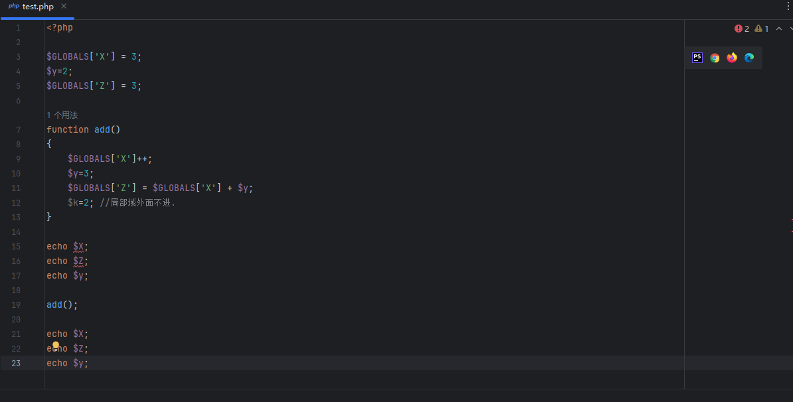
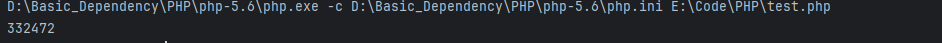
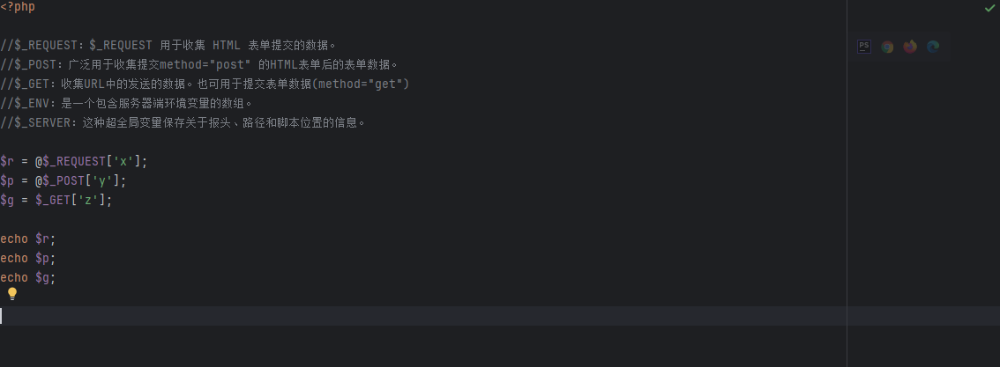
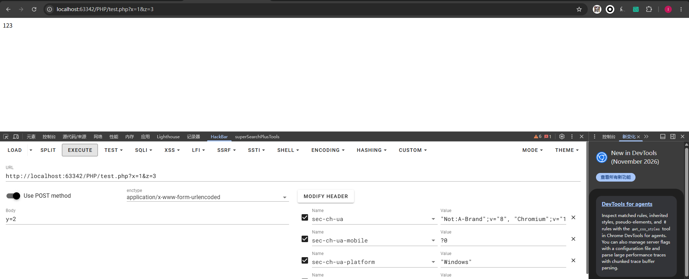
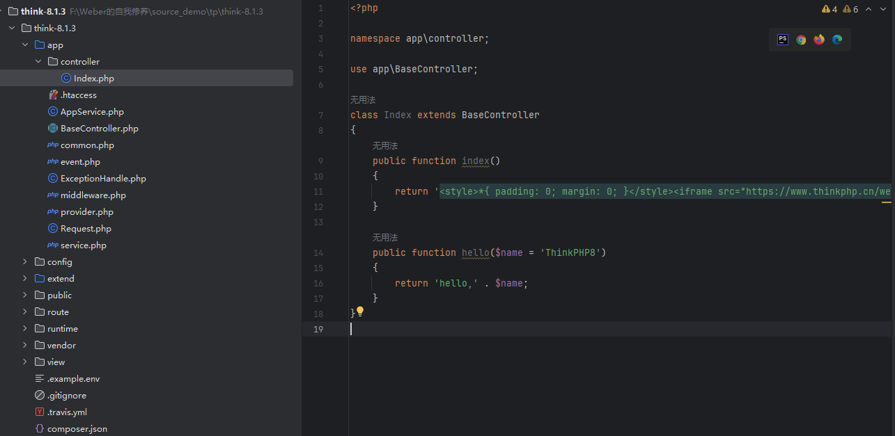
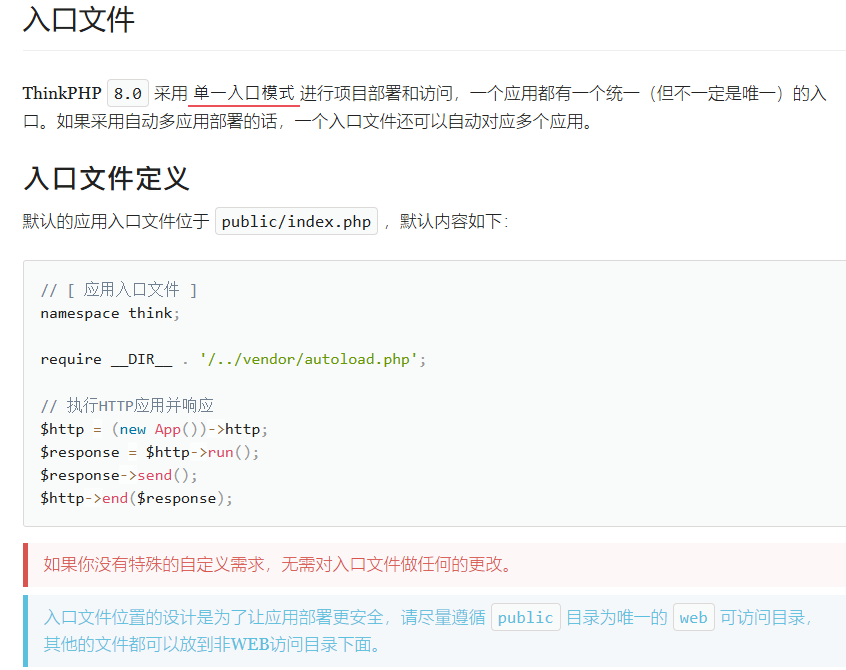
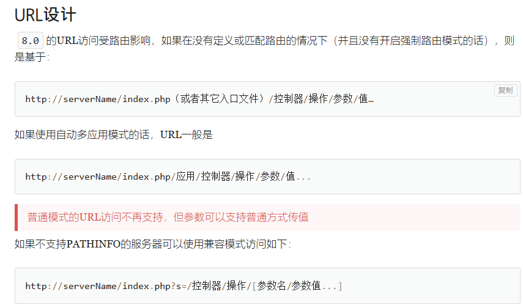
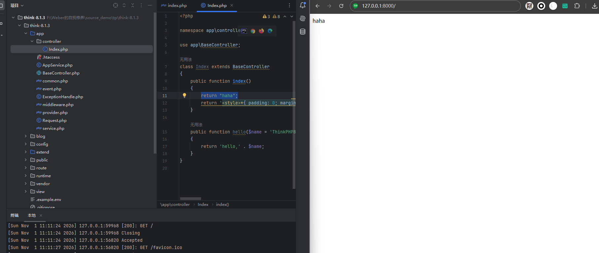
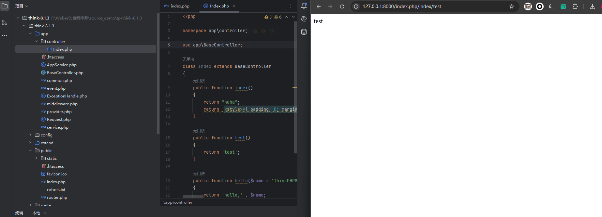
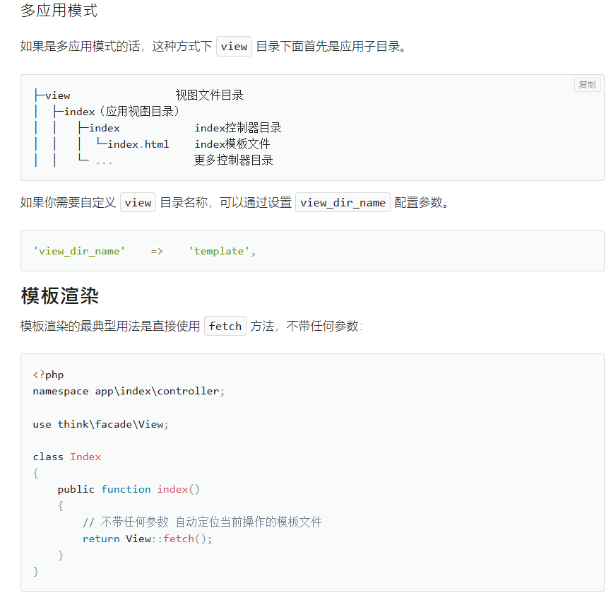

# 前言

一个 Web 狗的自我修养。


学了这么久了,也有一年了,浑浑噩噩的,抽课余时间学.还是很菜.又到了找班上的年纪.在此发现对于web的学习或者说对于整个安全方向的学习,我着相了,为什么这么说呢.我总是想着从基础一步一步堆上去,但殊不知基础这个东西太广泛我觉得应该是遇到一个去学一个,在学某个点的途中一定有你还不知道的其他点就tm跟goto一样再点进去看接着学.看多了就记住了.


# PHP相关

这期是php相关的一些基本内容.

## 超级全局变量

```text
变量覆盖安全：

$GLOBALS：这种全局变量用于在PHP脚本中的任意位置访问全局变量
数据接收安全：

$_REQUEST：$_REQUEST 用于收集 HTML 表单提交的数据。
$_POST：广泛用于收集提交method="post" 的HTML表单后的表单数据。
$_GET：收集URL中的发送的数据。也可用于提交表单数据(method="get") 
$_ENV：是一个包含服务器端环境变量的数组。
$_SERVER：这种超全局变量保存关于报头、路径和脚本位置的信息。
文件上传安全：

$_FILES：文件上传且处理包含通过POST方法上传给当前脚本的文件内容。
身份验证安全：

$_COOKIE：是一个关联数组，包含通过cookie传递给当前脚本的内容。本地客户端浏览器存储
$_SESSION：是一个关联数组，包含当前脚本中的所有session内容。目标服务端存储，存储记录的数据
```

超级全局变量$GLOBALS



如图所示,当然下面的也可以直接写`echo $X`这也是没问题的，会报错但是还是会执行。其实就是一个变量生存周期的问题，经过$GLOBALS[]来定义的变量是作用在全局域的，而function内部是函数域不会对其进行修改。就算我这里最开始是$GLOBALS['y']然后函数内部依然这样写也是不会动被GLOBALS修饰的变量y的。也就是说$y在函数内部被创建和销毁。就像这里在add()函数里，我们定义了一个变量y令他=3但是原本的y=2，最终函数执行后的结果也一定是y=2。



没有打换行大家将就看看，而函数内部写了`$GLOBALS['Z'] = $GLOBALS['X'] + $y;`这个时候执行的实际上是y=3了，因为函数域下认的是写在{}里面的`$y=3;`。一句话说完，`$GLOBALS[]`定义的变量它的作用域更广且只和代码上下顺序有关。所以可以用`$GLOBALS[]`去覆盖`$`定义的变量。

下面是一个最好理解的发请求的例子



REQUEST呢无论你发get还是post请求都是可以获取到参数的，其他的就各论个的。



遇到这种`$c = $_COOKIE['c']`这种也是一样的我们在改请求头的时候传一个cookie的值为c=...他也是接收到的。其他的就不多演示了。这里的`@`是抑制错误输出的，但是现在高版本已经不这么用了。因为会隐藏真正的问题。

至于COOKIE和SESSION这俩它的区别在于前置是在客户端存储，后者是在服务端存储。注意后者需要使用`session_start()`来开启使用session。超级全局变量的覆盖可能会在处理用户输出的时候使用到，但是具体要看源码，一般使用这样的超级全局变量的覆盖多数是白盒里面找到的，黑盒一般不会是这个思路。有更多详细的信息关于超级全局变量可以看菜鸟教程https://www.runoob.com/php/php-superglobals.html这里不占过多的篇幅。当然有个特殊的稍微记忆一下就好了

```php
$a = "aaa";
$$a = 111;
echo $aaa;
//输出111
```

这个其实拆开就很好理解了，先算`$a`再算`$($a)`这个意思所以才有了`$aaa == 111 `。

## Cookie&Session

前者保存在客户端，实际上是一个记录身份校验信息的文件，可能是保存的账密的序列化字符串或者其他的，这个可以由setcookie来定义，后者保存在服务端，其形式也是一个序列化字符串，但是他在浏览器中不直接显示值而是显示的是session的那个文件名如PHPSESSID:18e9asdl21easd之类的。而cookie在浏览器不加密的情况下可以直接看到其中的值，当然这俩东西都不一定要保存密码或者账号，只要是开发者认为是能用作身份校验的就可以放里边。而后者要启用需要使用`session_start()`

```php
$_SESSION['user_id'] = 123; 
$_SESSION['username'] = 'zhangsan'; 
$_SESSION['cart'] = ['商品A', '商品B'];      // 购物车 
$_SESSION['login_time'] = time(); 
$_SESSION['permissions'] = ['admin', 'edit']; 
$_SESSION['temp_data'] = $someArray;
```

一个简单的登录示例

```php
<?php
session_start();

if (isset($_SESSION['user_id'])) {
    echo "已登录，用户ID：" . $_SESSION['user_id'];
} else {
    echo "未登录";
}
```

## Token

token分防CSRF的token，一次性token，JWT(后面再说)等，CSRFtoken呢就是我们之前提到的session。我们说session可以存数据然后给客户端的返回形式是他的文件名，那么如果说我们把token存入session中那么服务端就会得到某一个值。而不同session存的token不一样所以就有效防御了CSRF.什么意思呢，就是说我们每次生成一个校验值(token)交给服务器存起来，每次你交互的时候服务器会对比这个token是不是你的。比如别人拿到了账密从其他地方登录发现客户端携带的token和服务端存储的token对应不上他就不会校验账密。另一种一次性token呢就是每次会话生成一个新的校验值，交互时先校验那个值再校验账密就能防止burp的重放。但是一旦下一个token变得可预测一样可以去爆破。

## 弱比较

弱比较的本质就追溯到`==`和`===`中，其实在实战中基本很难遇到这个点，在CTF赛制还是要出现。原因在于`==`会在比较前进行隐式类型转换，会把不同类型转换成相同类型进行比较，而`===`不会进行类型转换，通俗来说就是后者会即比较类型又比较值。下面是一些常见的`==`类型转换的案例。这里不会深究因为网上一搜一大坨当然也记不完，我们把特殊的记住然后到时候是在不行打开IDE自己敲两个出来也可以。

```php
0 == "0"          // true
0 == "0e123"      // true
0 == "abc"        // PHP 7：true（非数字字符串转成 0）；PHP 8：false
1 == "1abc"		 // PHP 7：true；PHP 8：false
0 == null         // true
0 == false        // true
"0e123" == "0e456" // true（都转成数字 0）科学计数法
true == "1"       // true
```

> 注意版本：PHP 8 收紧了数字与字符串的比较——比较时不再把非数字字符串转成 0，而是把数字转成字符串再比。所以 `0 == "abc"`、`1 == "1abc"` 在 PHP 8 里都是 false，只有 `0 == "0"`、`0 == "0e123"` 这类数字字符串仍然成立。审计时先确认目标跑的是哪个版本。

`strcmp($a, $b)`这个函数用于比较a和b两个谁更大，`$a < $b 返回负数，$a == $b 返回 0，$a > $b 返回正数`。PHP 7 及以前参数传数组会被当成 null、函数返回 null，所以能绕过；PHP 8 起参数类型不符直接抛 TypeError，这条路就断了。

```php
strcmp([], "abc") == 0   // PHP 7：true（null == 0）；PHP 8：TypeError
```

`in_array`和`array_search`两者默认是弱比较，其实这两个函数有三个参数前两个分别是值和数组，后面有一个参数来决策开不开强比较。

```php
in_array(0, ["admin", "user"])     // PHP 7：true；PHP 8：false
in_array(0, ["0e123", "abc"])      // true（"0e123" 是数字字符串，PHP 8 也成立）

array_search(0, ["admin", "user"]) // PHP 7：返回 0（键名）；PHP 8：返回 false
```

这个时候就是弱比较。还有就是下面的`md5()`这个函数，当然也可以使用数组绕过传两个数组过去

```php
md5("240610708")  === "0e462097431906509019562988736854"  // 字符串
md5("QNKCDZO")    === "0e830400451993494058024219903391"

// 弱比较时：
md5("240610708") == md5("QNKCDZO")   // true（0 == 0）
"0e123" == "0e456"                   // true
```

一个经典的CTF题目相信很多人都做过。

```php
if ($_GET['a'] != $_GET['b'] && md5($_GET['a']) === md5($_GET['b'])) {
    echo "flag{...}";
}
```

这个时候就可以`?a[]=1&b[]=2`来绕过，原理也说了数组类型会被转换为null类型最后都会相等。不过这也是 PHP 7 及以前的玩法，PHP 8 下 `md5()` 收到数组直接抛 TypeError，脚本会挂但拿不到 flag。

数组绕过

```php
md5([])           // PHP 7：null（带 warning）；PHP 8：TypeError
sha1([])          // PHP 7：null；PHP 8：TypeError
strcmp([], "xx")  // PHP 7：null；PHP 8：TypeError

null == 0         // true
null == false     // true
null == ""        // true
```

很多字符串函数在 PHP 7 下收到数组会返回 null。至于反序列化中的弱比较问题其实实际上还是`==`问题的放大。

```php
$obj = unserialize($_GET['o']);

if ($obj->user == "admin" && $obj->pass == $correct_pass) {
    // 成功
}
```

比如这样的代码，然后我们来看反序列化后的一个序列`O:4:"user":2:{s:1:"a";i:0;s:1:"b";a:0:{}}`这是一个序列化的结果，具体怎么解释就不多说了。当看到校验的时某一个具体属性时我们只需要在类中去修改属性满足局部就完了呗。

## smarty

smarty是php的一种模板引擎，形如`{$<变量名>}`而这个变量可以执行表达式。模板的本意是为了方便修改。这个东西说白了就是调用。

```php
<?php
require_once __DIR__ . '/libs/Smarty.class.php';

$smarty = new Smarty();

// 配置目录
$smarty->setTemplateDir(__DIR__ . '/templates/');
$smarty->setCompileDir(__DIR__ . '/templates_c/');
$smarty->setCacheDir(__DIR__ . '/cache/');

// 关闭缓存（开发时建议关闭）
$smarty->caching = false;

// 赋值变量
$smarty->assign('title', 'Smarty Demo');
$smarty->assign('name', '张三');
$smarty->assign('age', 22);
$smarty->assign('users', [
    ['id' => 1, 'name' => 'Alice', 'score' => 95],
    ['id' => 2, 'name' => 'Bob',   'score' => 88],
    ['id' => 3, 'name' => 'Charlie','score' => 76],
]);
//index.tpl中可能就这样写的嘛，{$name}这个实际渲染就是1张三撒。users这里可以通过id绑定来看不同的{$name}的值嘛。比如{$use}
// 渲染模板
$smarty->display('index.tpl');
$smarty->display($_GET['a']);//这儿个地方如果我们这样写
```

来看一个demo，看最后一行如果我们这样来处理输入，实际上真正渲染模板的代码是最后一行这个写法。其实这也同时给了我们一个代码审计点，找模板渲染的实际是哪个文件或者参数，当参数或文件可控时就可以走SSTI，同时还要看版本信息，不同版本模板引擎的编译逻辑和渲染逻辑不一样，还有编译的产物也不一样。下面是一个示例的tpl

```html
<!DOCTYPE html>
<html lang="zh-CN">
<head>
    <meta charset="UTF-8">
    <title>{$title}</title>
    <style>
        body { font-family: Arial, sans-serif; margin: 40px; }
        table { border-collapse: collapse; width: 400px; }
        th, td { border: 1px solid #ccc; padding: 8px; text-align: left; }
        th { background: #f0f0f0; }
    </style>
</head>
<body>

    <h1>{$title}</h1>

    <p>你好，{$name}！你今年 {$age} 岁。</p>

    <h3>用户列表：</h3>
    <table>
        <tr>
            <th>ID</th>
            <th>姓名</th>
            <th>分数</th>
        </tr>
        {foreach $users as $user}
        <tr>
            <td>{$user.id}</td>
            <td>{$user.name}</td>
            <td>{$user.score}</td>
        </tr>
        {/foreach}
    </table>

    {* 这是注释，不会显示 *}

    {if $age >= 18}
        <p style="color: green;">已成年</p>
    {else}
        <p style="color: red;">未成年</p>
    {/if}

</body>
</html>
```

模板当然还有很多倒是遇到一个看一个就成，先以smarty为例而已。

## 框架

这里以thinkphp为例来说说



入口文件



手册里说的很清楚，也就是说正常的入口就是public目录下的index.php。



URL访问，其实说的是URL中的目录对实际源码目录的映射关系。搭建出来看看



实际看到的根目录是/app/controller/index.php。



这样就能很清楚的看到URL访问，/index.php是入口。根据手册看的由入口进去，控制器就是controller下面的那个文件，这里叫index.php嘛那控制器就是index。里面写的test方法，那就直接访问就行了。和tp5.0的访问一样的。反正就根据文档看怎么写的就行了。主要是要看懂它的写法比如：

```php
Db::table('think_user')->where('id', 1)->find();
//SELECT * FROM `think_user` WHERE  `id` = 1 LIMIT 1
```

这两个写法是等价的，我们需要看得懂他这是什么意思才行。还有结合我们之前提到的模板渲染，需要有保存模板的位置



前端的比如我渲染的是index.html那么就直接像我们之前提到的tpl那样写就行了。我们需要知道的是它的结构是什么样的，这样才能快速定位文件。重点是两处：入口 `public/index.php`；模板目录（TP5 在 `application/应用名/view`，TP6 在 `app/应用名/view`），模板后缀常见 `.html`、`.tpl`。

## 一些命令执行审计点

低版本的就不再说了。其实一个我常用的审计思路就是找exec,excute,eval,system啊之类的全局搜。我们以最常见的一句话木马来说

`<?php eval($_GET['a']);?>`它本身的意义其实是代码执行只不过我们在输入a参数的值时习惯这样写system('ls');所以严格来说是因为代码执行导致的命令执行。文件包含也是一个道理——包含实际上是把那个文件当 php 执行。

```php
eval();//这些就不细说了太常见了
assert();//PHP 7 及以前传字符串会当代码执行；PHP 8 起不再执行字符串
exec();
system();
passthru();
require('1.txt');# <?php eval(system('whoami'));?>
include();
create_function('$a,$b', 'return $a+$b');
/*这个就等同于*/
function add($a,$b){
    return $a+$b;
}//一个老案例这样写create_function('$a,$b',';}phpinfo()/*');
那么有可能就是这样的create_function('$a,$b', $_GET['cmd']);那么就控制cmd参数呗。
```

# 总结

总的来说呢，可以总体串一下很多语言我们说的弱语言也好，解释型的也好其实很多东西是相似的，我们需要的是思路，不要以开发的眼光去看待代码审计。像smarty这种模板引擎就是可以类比像python的，js的，java的等等其它语言的。本文并没有事无巨细的说完所有的这些但是用来扫盲还是将就。这里笔者建议前期可以多看看漏洞复现，之前笔者也学的很乱但是现在串一串之后感觉还好正好还有一些能够补上，当然这期仍然是基础也许没有说完，师傅们轻点喷。